# Dark City

**One night, one street, three bosses.**

Dark City is a 2D pixel-art **run-and-gun platformer** made with **Godot 4.7** and **GDScript**.
You play a SWAT officer fighting through a rainy downtown street at night. You shoot thugs, jump
between rooftops and clear three boss arenas to take the city back.

It opens with a short cinematic, has full settings (audio, video, key and gamepad rebinding),
supports Xbox and PlayStation 2/3/4/5 controllers, saves your progress, lets you customise your
officer, and has an original synthesised soundtrack with CC0 sound effects.

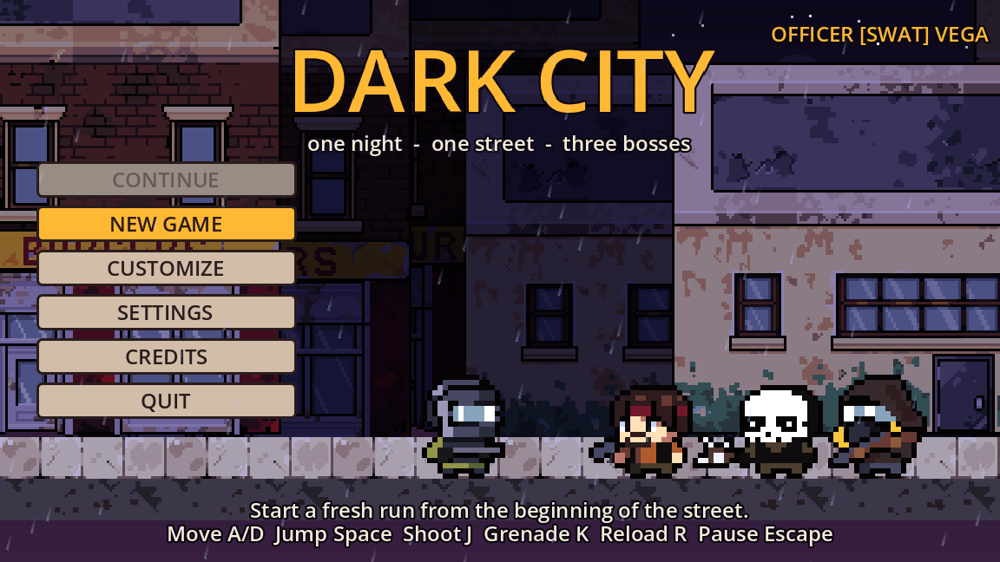

---

## Why this project exists

Dark City was built to answer a simple question: *what does a small game look like when it is
actually finished?* Not a prototype with one mechanic, but a complete loop: title screen,
controls, a level, enemies, bosses, a HUD, pause, game over, victory and restart. It is built
entirely from one free pixel-art pack.

It has two goals:

1. **Be a complete, polished, short game.** It plays in a few minutes, and its feel is tuned with
   coyote time, jump buffering, hit-stop, screen shake and readable boss patterns.
2. **Be a learning resource.** The code is small (about 4,300 lines), commented and structured
   with common Godot patterns (event bus, inheritance, state machines, data-driven levels). The
   [`docs/`](docs/README.md) folder includes **[Let's learn](docs/lets-learn/README.md)**, a full
   course that rebuilds this game from an empty folder and teaches GDScript along the way.

---

## Screenshots

| | |
|---|---|
| 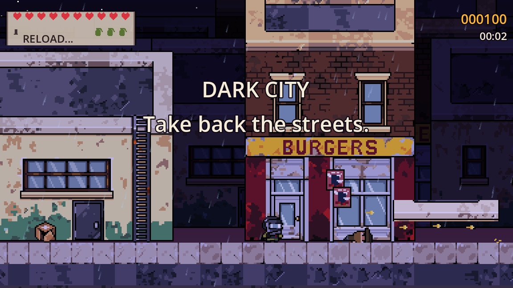 **Street fight**: rain, parallax skyline, HUD | 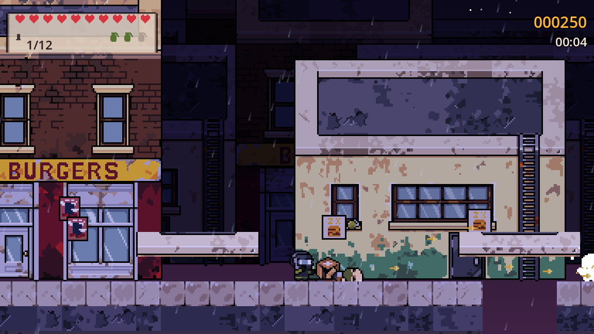 **Grenades**: arcs, bounces, 64 px explosions |
| 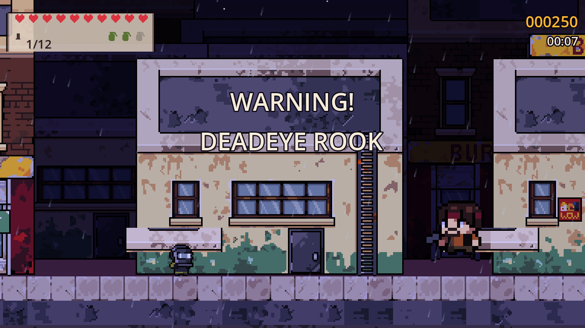 **Boss arena**: walls close, camera locks, WARNING banner | 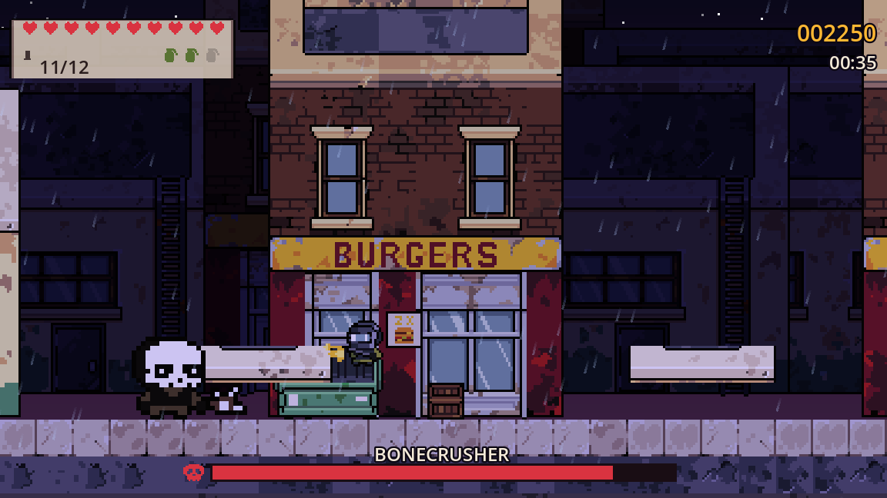 **Boss 2, Bonecrusher**: charges, leaps, shockwaves |
| 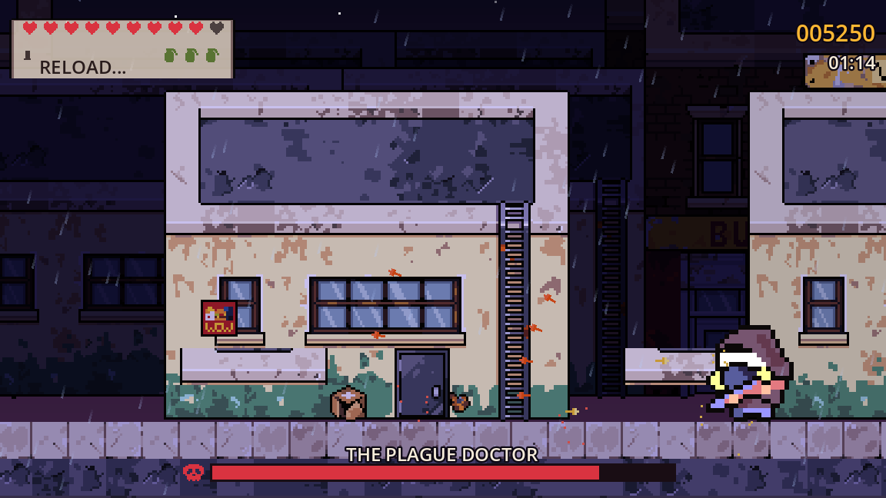 **Final boss, The Plague Doctor**: bullet fans, grenades, summons | 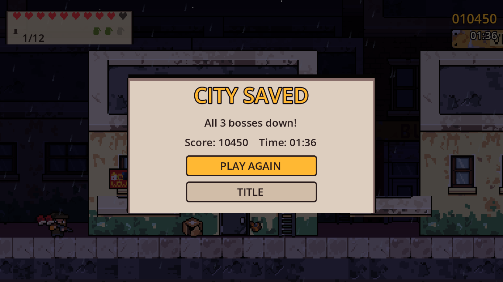 **City saved**: final score and time |
| 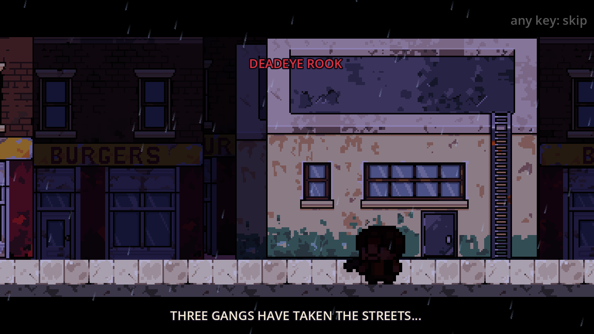 **Intro cinematic**: lightning, letterbox, typewriter narration | 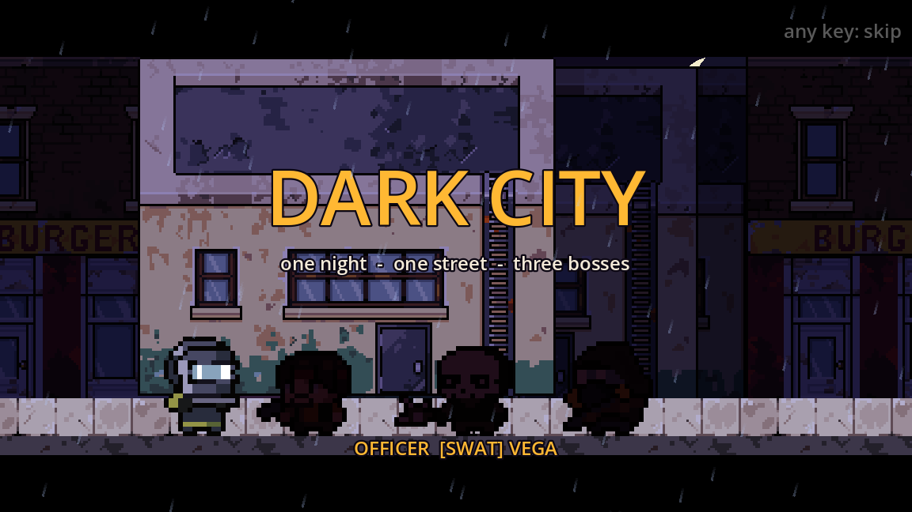 **Logo slam** with an RGB-split glitch |
| 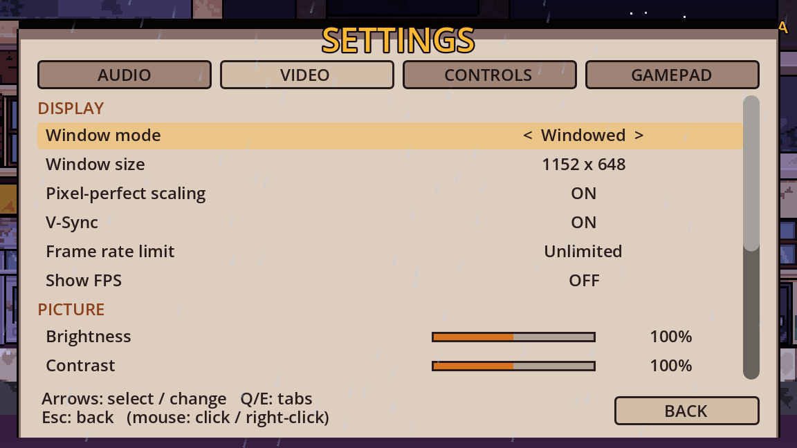 **Settings**: window, resolution, brightness, rain, shake… | 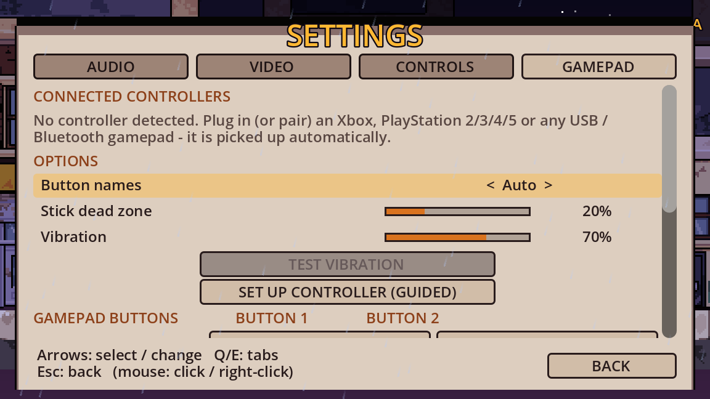 **Gamepad tab**: detection, vibration, guided set-up, rebinding |
| 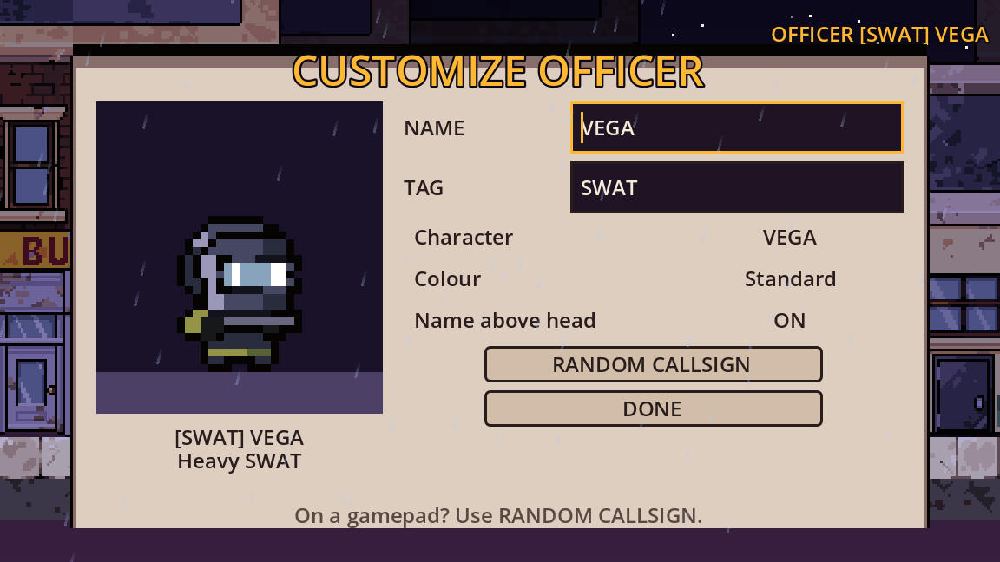 **Customize**: name, tag, 3 characters, 7 colours | 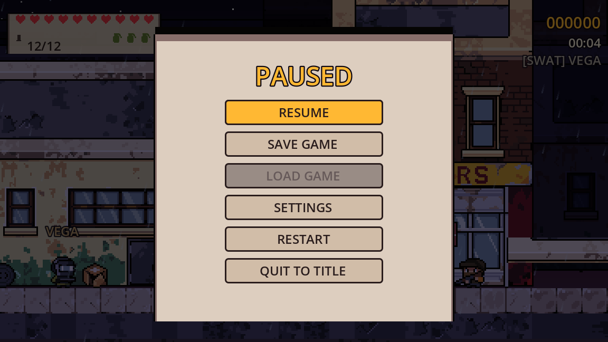 **Pause menu**: save, load, settings |

Gameplay screenshots were captured by the playtest bot (`tools/playtest.gd`), menu screenshots by
`tools/menu_shots.gd`.

---

## Features

* **Tight platformer controls:** acceleration, variable jump height, coyote time, jump buffering,
  drop-through platforms.
* **Combat:** auto-fire pistol with a 12-round magazine and reload, bouncing grenades, knockback,
  invulnerability frames.
* **Two enemy types:** *Gunner* (keeps his distance, fires bursts) and *Brute* (sprints in, swings
  an axe).
* **Three bosses with state-machine AI** and a phase 2 below 50 % HP:
  * **Deadeye Rook**: aimed bursts and bullet fans, with a reload window you can punish.
  * **Bonecrusher**: telegraphed charges that stun him against walls, plus leaps with shockwaves.
  * **The Plague Doctor**: spread volleys, lobbed grenades, dashes, and summoned gunmen.
* **Atmosphere:** procedurally decorated street, two-layer parallax skyline, twinkling stars, a
  crescent moon, rain particles, a night tint.
* **Game feel:** screen shake, hit-stop, hit flashes, sparks, chained boss-death explosions,
  gamepad rumble.
* **Intro cinematic:** lightning reveal, panning parallax street, typewriter narration, bosses
  flashing in, your officer walking in, logo slam. Skippable with any key.
* **Main menu:** CONTINUE, NEW GAME, CUSTOMIZE, SETTINGS, CREDITS, QUIT, over an animated street
  with rain, lightning and a flickering neon logo.
* **Pause menu:** RESUME, SAVE GAME, LOAD GAME, SETTINGS, RESTART, QUIT TO TITLE. Music gets muffled
  while paused.
* **Save & load:** save from the pause menu, automatic checkpoint after each boss, continue from
  the title or the game-over screen.
* **Customisation:** player name and tag, three characters (heavy SWAT, riot officer, night
  operator), seven colour tints, name tag above your head.
* **Settings (all applied live):**
  * *Audio:* master, music, effects, ambience, menu volumes.
  * *Video:* window mode (windowed / borderless / exclusive fullscreen), window size up to 4K,
    pixel-perfect scaling, V-Sync, FPS limit, FPS counter, brightness, contrast, gamma,
    scanlines, vignette, rain (off/light/normal/heavy), lightning flashes, screen shake, intro on/off.
  * *Controls:* rebind every action, 3 keys each, with conflict handling.
  * *Gamepad:* automatic detection of **Xbox, PlayStation 2 (USB adapter), PS3, PS4, PS5**,
    Switch and generic pads, with the right button names ("A" vs "Cross"); rebinding; a guided
    set-up for unusual pads; stick dead zone; vibration strength and test.
* **Audio:** six original music tracks (intro, title, street, boss, victory, game over), 31 sound
  effects, rain ambience, positional sound.
* **Developer tools:** asset pipeline scripts, a level generator, an automated playtest bot and a
  screenshot tool.

---

## Prerequisites

| Requirement | Details |
|---|---|
| **Godot Engine 4.7** | The *standard* build from <https://godotengine.org/download> (the .NET/C# build isn't needed). Older 4.x versions may fail to open the project, because it uses `TileMapLayer`, `Parallax2D` and newer GDScript features. |
| **GPU** | Vulkan-capable graphics (the project uses the Forward+ renderer). On Windows it uses Direct3D 12. |
| **OS** | Linux, Windows or macOS, anything Godot 4.7 supports |
| **Disk space** | About 100 MB for Godot, plus a few MB for the project |
| **Optional** | Git, to clone the repository. A gamepad. |

There are no other dependencies: no plugins, no package manager, no external tools.

---

## How to run

### Option A — from the Godot editor (recommended)

1. Get the project:
   ```bash
   git clone https://github.com/KaijoNo7/dark-city.git
   ```
   (or download and unzip it).
2. Start Godot 4.7. In the **Project Manager** click **Import**, select the `project.godot` file
   inside `dark-city/`, and click **Import & Edit**.
3. The first time, Godot imports all the images. Wait for it to finish.
4. Press **F5** (or the ▶ button at the top right) to play. The intro plays first (any key skips
   it), then the title screen.

> **The editor opens on an empty scene?** Godot reopens the scenes that were open last time. In the
> **FileSystem** dock, double-click `scenes/level/level_1.tscn` to see the level. `intro.tscn`,
> `title.tscn` and `hud.tscn` look almost empty in the editor because their UI is built in code.
> Run them to see it.

### Option B — from the command line

```bash
cd dark-city
godot --path .                 # run the game (intro, then title screen)
godot --path . -e              # open the editor
godot --path . res://scenes/level/level_1.tscn   # jump straight into the level
```

### Option C — run the automated playtest

```bash
godot --path . --fixed-fps 60 res://tools/playtest.tscn            # watch the bot play
godot --path . --headless --fixed-fps 60 res://tools/playtest.tscn # logic only, prints a report
godot --path . --headless --fixed-fps 60 res://tools/playtest.tscn -- save   # save/load test
godot --path . res://tools/menu_shots.tscn                         # screenshot every menu
```

### Exporting a standalone build

Install the export templates (**Editor → Manage Export Templates**), then use
**Project → Export…**. Details are in
[docs/technical/04-testing-debugging-export.md](docs/technical/04-testing-debugging-export.md).

---

## Controls

| Action | Keyboard | Mouse | Gamepad |
|---|---|---|---|
| Move | A / D or ← / → | | D-pad / left stick |
| Jump (hold = higher) | Space, W or ↑ | | A |
| Shoot (hold = auto-fire) | J or X | Left button | X |
| Throw grenade | K or C | Right button | B |
| Reload | R | | Y |
| Drop through platform | S + Space | | Down + A |
| Pause | Esc or P | | Start |

All of these can be changed in **SETTINGS → CONTROLS / GAMEPAD**. Menus also work with the mouse,
arrows + Enter/Esc, or the d-pad + A/Cross and B/Circle (LB/RB or Q/E switch settings tabs).

Your settings and save live in Godot's user folder (`~/.local/share/godot/app_userdata/Dark city/`
on Linux, `%APPDATA%\Godot\app_userdata\Dark city\` on Windows). Delete `settings.cfg` to reset
the options, `savegame.json` to erase the save.

---

## Project structure

```
dark-city/
├── project.godot      engine settings, input map, autoloads
├── asset/             Craftpix art pack (unmodified) + audio/ (music and sound effects)
├── resources/         generated SpriteFrames and TileSet
├── scenes/            player, enemies, bosses, projectiles, pickups, level, ui
├── scripts/           one script per scene, shared base classes, and the autoloads
│                      (Settings, Audio, SaveGame, Game)
├── tools/             asset pipeline, level builder, playtest bot, screenshot tools,
│                      audio/ (sound-effect importer, music generator)
├── docs/              full documentation and the "Let's learn" course
└── DEV_LOG.md         the original development log
```

The architecture in brief: gameplay objects announce events on a global **event bus**
(`scripts/autoload/game.gd`), and the HUD and camera react to them. Enemies share a base class
(`EnemyBase`), and bosses add a state-machine layer (`BossBase`). Three service autoloads handle
preferences and controllers (`Settings`), sound (`Audio`) and the save slot (`SaveGame`). See
[docs/architecture](docs/architecture/README.md).

---

## Documentation

| Section | |
|---|---|
| [📚 Documentation index](docs/README.md) | Start here |
| [⚙️ Technical](docs/technical/README.md) | Project settings, input, physics layers, tools, testing, export, options / saves / controllers |
| [🏗️ Architecture](docs/architecture/README.md) | Folder layout, scenes, communication, script reference |
| [🎨 Graphics](docs/graphics/README.md) | Art pack, sprites and animation, tiles, parallax, UI, palette |
| [🎮 Gameplay](docs/gameplay/README.md) | Game design, enemies, bosses, tuning reference |
| [🔊 Audio](docs/audio/README.md) | Music, sound effects, the Audio autoload, how the soundtrack is synthesised |
| [🎓 Let's learn](docs/lets-learn/README.md) | A 16-chapter course: build this game from scratch and learn GDScript (chapters 13–15 cover menus, settings, saves, controllers, audio and the intro) |

---

## Credits & licence

* **Art:** a pixel-art city pack by [Craftpix](https://craftpix.net), stored in `asset/`. Its licence
  is in [`asset/Licens.txt`](asset/Licens.txt) (see <https://craftpix.net/file-licenses/>).
  Check it before publishing or selling a build.
* **Sound effects:** *The Essential Retro Video Game Sound Effects Collection [512 sounds]* by
  **Juhani Junkala**, released under **CC0** on
  [OpenGameArt](https://opengameart.org/content/512-sound-effects-8-bit-style).
* **Music:** original, synthesised by `tools/audio/compose_music.py` for this project.
* **Engine:** [Godot Engine](https://godotengine.org) (MIT licence).
* **Code:** no licence has been chosen for this repository's code yet. Add a `LICENSE` file before
  sharing it publicly.
