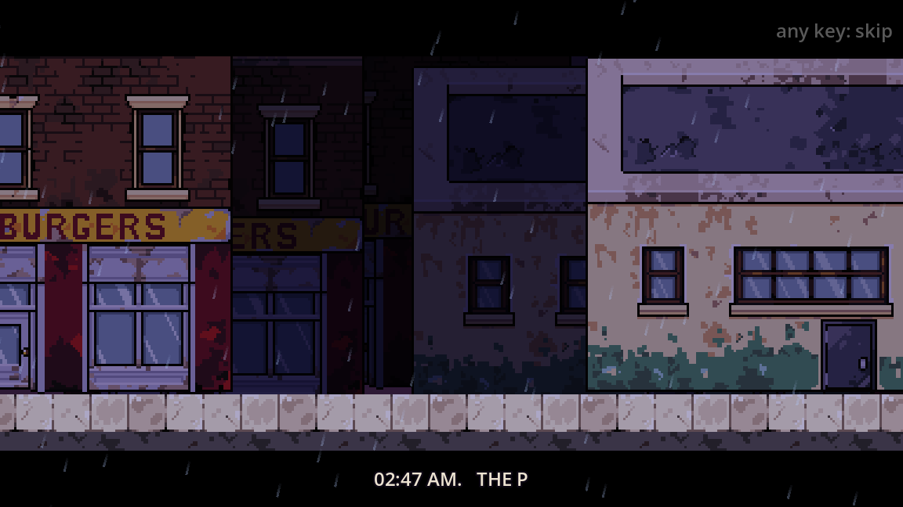
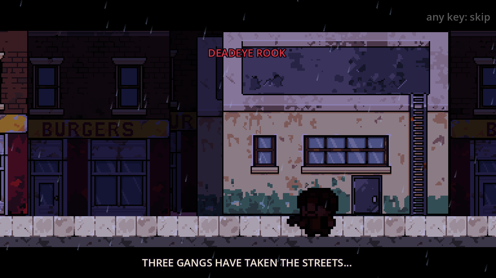
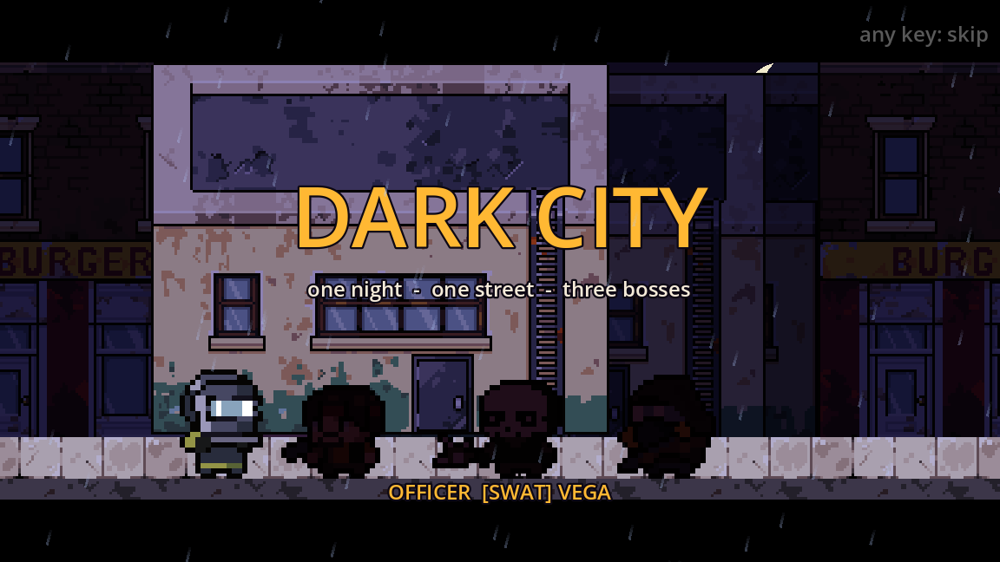
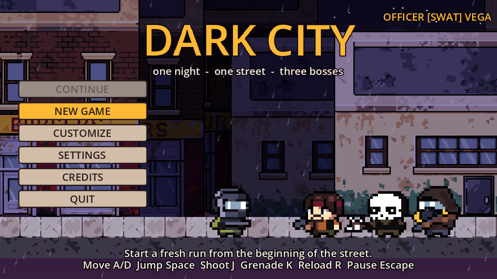
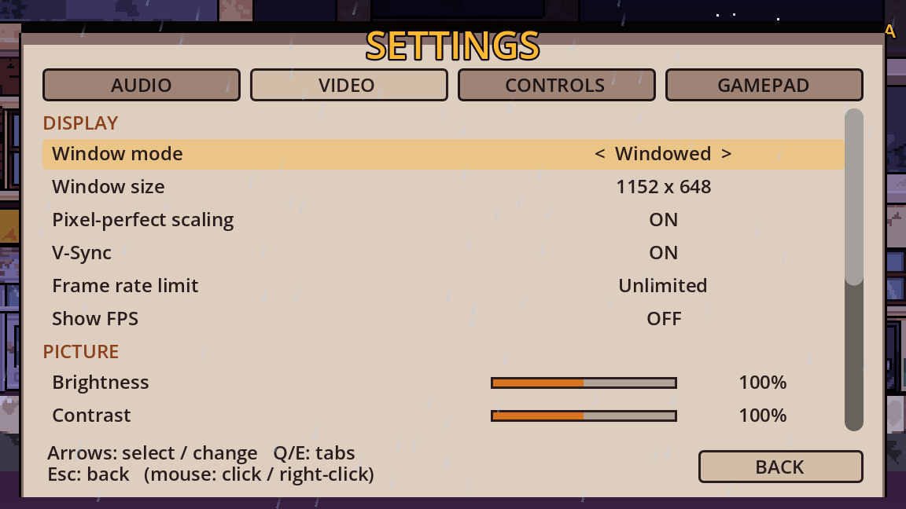
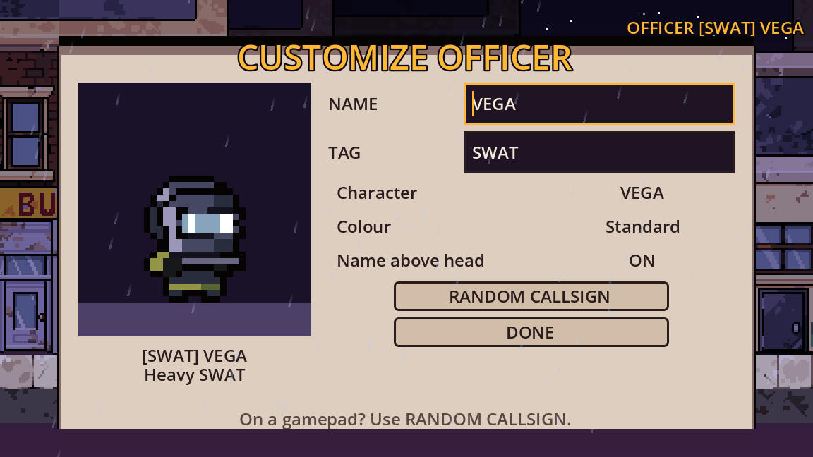
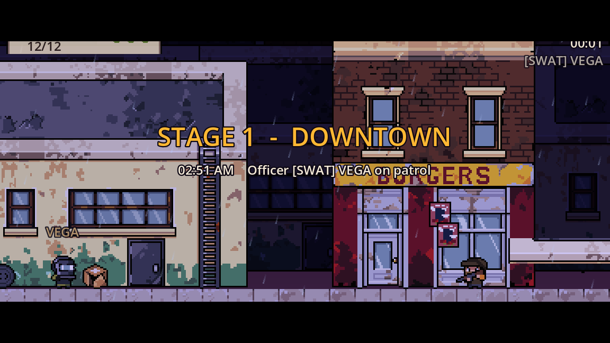

# 04 — UI, effects & palette

## The UI is built in code

`hud.tscn` and `title.tscn` each contain **one node**. Every label, icon, panel and button is
created in `_ready()` with helpers from `scripts/ui/ui_kit.gd`.

**Why build UI in code here?**

* Positions are exact pixel numbers on a 384 × 216 canvas, so code is as precise as the editor.
* A shared helper (`UI.label`, `UI.button`, `UI.dialog`) guarantees consistent styling.
* The HUD and title can be read top-to-bottom as one script.

**Trade-off:** you can't see the layout in the editor without running the scene (F6). For bigger
UIs, a hand-built scene with a `Theme` resource is usually better. See the exercises in
[Let's learn, chapter 11](../lets-learn/chapter-11-user-interface.md).

## UI kit (`ui_kit.gd`)

`extends RefCounted`, and every function is `static`, so it's a **function library**. Nobody
creates an instance. You use it through `const UI := preload("res://scripts/ui/ui_kit.gd")`.

| Helper | Builds |
|---|---|
| `UI.icon(33)` | `load("res://asset/UI/Icons/33.png")` |
| `UI.panel(size)` | `NinePatchRect` over `UI.png` region `(112,108,48,48)`, 4 px margins |
| `UI.label(text, size, color, outline)` | `Label` with font size/colour overrides, dark 3 px outline, centred |
| `UI.button(text, callable)` | `Button` 100×16, four `StyleBoxFlat`s (normal/hover/focus/pressed), `pressed` connected |
| `UI.dialog(title, info, buttons, title_color)` | Full-rect root → 60 % black dim → centred panel → `VBoxContainer` (title, info, buttons) |

### 9-slice panels

A **NinePatchRect** cuts a texture into 9 parts using the margins. Corners stay fixed, edges
stretch in one direction, and the centre stretches in both. One small 48 × 48 frame can become a
98 × 30 status box or a 190 × 130 dialog without distorting the border.

```
┌──┬────────┬──┐
│C │  edge  │C │   C = corner (never stretched)
├──┼────────┼──┤
│e │ centre │e │
├──┼────────┼──┤
│C │  edge  │C │
└──┴────────┴──┘
```

## HUD layout (384 × 216)

```
┌────────────────────────────────────────────────────────────┐
│┌──────────────┐                                 000100    │  score: accent, 10 px, right-aligned
││♥♥♥♥♥♥♥♥♥♥    │                                  00:42    │  time: light, 8 px
││▮ 12/12  ● ● ●│                                           │
│└──────────────┘                                           │
│                   WARNING!                                │  centre message at y=55, 16 px,
│                 DEADEYE ROOK                              │  fades in 0.15 s, out 0.4 s
│                                                           │
│                                                           │
│                  DEADEYE ROOK                             │
│              ☠ ▇▇▇▇▇▇▇▇▇▇▇▇▇▇▇▇▇▇▇▇                       │  boss bar: 200 px wide at y=192
└────────────────────────────────────────────────────────────┘
```

| Element | Source | Behaviour |
|---|---|---|
| Hearts ×10 | icon 33 at 0.5 scale (8 px), 9 px apart | Red if `i < hp`, grey otherwise. Hidden if `i >= max_hp`. |
| Bullet icon + ammo | icon 26 + Label | Shows `"RELOAD..."` while reloading |
| Grenades ×3 | icon 1 | Olive if available, near-transparent if used |
| Score | Label `"%06d"` | Zero-padded to 6 digits |
| Time | `Game.format_time()` | Updated every frame |
| Boss bar | skull icon 25 + 2 `ColorRect`s | Width tweens to `200 × hp / max_hp` over 0.15 s |

**Why tween the boss bar:** an instant jump is hard to notice. A 0.15 s slide shows *how much*
damage you did.

## Dialogs

| Dialog | Trigger | Buttons |
|---|---|---|
| PAUSED (accent title) | Esc / P / Start | RESUME, SAVE GAME, LOAD GAME, SETTINGS, RESTART, QUIT TO TITLE |
| LOAD GAME? (accent title, 300 px wide) | LOAD GAME | LOAD, CANCEL |
| YOU DIED (danger title) | `player_died` + 1.6 s | RETRY, LOAD LAST SAVE (if a save exists), TITLE |
| CITY SAVED (accent title) | final `boss_defeated` + 3 s | PLAY AGAIN, TITLE |

The first button **grabs focus**, so keyboard and gamepad users can confirm immediately.

## Intro cinematic (`intro.gd`)





| Time (approx.) | Beat | Technique |
|---|---|---|
| 0–3 s | "MADE WITH GODOT 4" on black | `modulate:a` fades |
| 3 s | lightning reveals the street | black overlay alpha 1 → 0.15 → 0.8 → 0 (a flash, then a slow reveal) + thunder 0.25 s later |
| 3–20 s | camera pans 200 px | `tween_method(backdrop.set_pan, 0, 200, 17 s)` with sine in-out easing; skyline moves at 0.3× (parallax) |
| 4–9 s | typewriter narration in the bottom letterbox bar | `Label.visible_characters` +1 every 45 ms, a soft blip per letter |
| 9–12 s | three bosses appear as black silhouettes, flash red, names appear | `modulate` tween: `(1.6, 0.3, 0.3)` (over-bright red) → `(0.12, 0.05, 0.1)` (silhouette) |
| 13–16 s | the player's officer walks in, name tag fades in | `walk` animation + position tween, uses the chosen character and tint |
| ~18 s | logo slams down | scale 3.5 → 1 with `TRANS_BACK` overshoot, slam sound, 12 frames of random jitter, red/cyan ghost copies offset for an RGB-split glitch that fades out |
| ~21 s | fade to black → title | |

**Letterbox:** two black 384 × 24 bars make the 16:9 screen feel like a 2.35:1 film frame. They
also give the captions a clean place to sit.

## Title screen composition



```
 OFFICER [SWAT] VEGA (top right, gold)
                      DARK CITY          ← 32 px, gold, neon flicker + slow "breathing" scale
         one night - one street - three bosses
 [ CONTINUE ]  (disabled if no save)
 [ NEW GAME ]
 [ CUSTOMIZE]        skyline silhouettes (2 layers) + street buildings
 [ SETTINGS ]
 [ CREDITS  ]       🧍           👤 👤 👤
 [ QUIT     ]      hero      3 bosses (2×)
═══════════════════ sidewalk tiles ═════════════════════  rain + lightning over everything
   <description of the focused button>
   Move A/D  Jump Space  Shoot J  ...   (or the gamepad's button names)
```

* The menu slides in from the left (cubic ease-out, 0.5 s).
* **Neon flicker:** a looping tween holds full brightness for 2.5 s, dips to 40–50 % twice in
  quick succession, then waits 4 s. Irregular timing reads as a faulty neon tube, not a blink.
* All four actors play `idle` at 2× with `speed_scale = randf_range(0.8, 1.2)`, so they don't
  breathe in perfect sync, which would look robotic. The hero updates live when you change the
  character or colour.

## Settings, customize and pause windows




* Same beige 9-slice panel as every dialog, with a 70 % black dim behind.
* Rows (`SettingRow`) have no background until hovered (18 % gold) or focused (40 % gold), so the
  focused row is obvious from across the room, even on a TV.
* Sliders: a 4 px bar, dark-brown frame, orange fill. Choices show `<  value  >` arrows only when
  focused, as a hint that left/right change them.
* Section headers are rust-brown (`Color(0.55, 0.25, 0.1)`), notes are muted brown.
* The customize preview is a dark-violet "stage" with a floor strip and the officer at 3×.



**Stage card** (`hud.show_stage_card`): letterbox bars slide in (0.4 s, cubic), the title (16 px
gold) and subtitle fade in, hold 2.2 s, then everything slides out and frees itself.

## Post-processing (`post_process.gdshader`)

A full-screen `ColorRect` on canvas layer 128 (owned by `Settings`) reads the finished frame with
`hint_screen_texture` and applies, in order:

```glsl
c = (c - 0.5) * contrast + 0.5;           // contrast around mid-grey
c *= brightness;                           // brightness
c = pow(max(c, vec3(0.0)), vec3(1.0 / gamma));   // gamma: lifts or deepens shadows
if (fract(SCREEN_UV.y * 216.0) > 0.5) c *= 1.0 - scanlines;  // one dark line per game pixel row
c *= 1.0 - vignette * dot(d, d) * 1.6;     // d = distance from the centre
```

`SCREEN_UV.y * 216.0` counts in *game* pixels, not window pixels, so the scanlines line up with the
art at any window size. When all values are neutral the rect is hidden.

## Weather (`weather.gd`)

* **Rain:** the same particle drop texture as before. *Rain* setting → `amount` 0 / 60 / 140 / 260
  and faster drops at higher levels.
* **Lightning:** a full-screen pale-blue `ColorRect` on layer 6 (above rain, below the HUD) flashes
  twice: alpha 0.55 (40 ms) → 0.05 → 0.35 → 0 over 0.5 s. Random every 9–22 s in the level and on
  the title; scripted in the intro. Turn it off with *Lightning flashes* (photosensitivity).

## Particle effects

| Effect | Node | Settings |
|---|---|---|
| Bullet spark | `CPUParticles2D` created in `bullet.gd` | one-shot, 6 particles, 0.25 s, explosiveness 1, spread 180°, 30–70 px/s, gravity 200, `spark_color`; frees itself on `finished` |
| Rain | `CPUParticles2D` in `level_1.tscn` (or made by `weather.gd` on the title/intro) | see [03](03-tiles-and-level-art.md); amount set by the *Rain* option |

`CPUParticles2D` (rather than `GPUParticles2D`) is simple to set up from code and fine for a few
hundred particles. It also works with the Compatibility renderer.

## Motion effects

| Effect | How | Strength used |
|---|---|---|
| **Screen shake** | `Camera2D.offset` = random ±strength px, decays at 20 px/s; scaled by the *Screen shake* setting | shot 0.8, boss intro 3, hurt 4, explosion 5, wall slam 6, boss death 8 |
| **Hit-stop** | `Engine.time_scale = 0.05` for N real seconds | player hurt 0.06 s, boss death 0.15 s |
| **Recoil** | `velocity.x -= facing * 8` per shot | |
| **Knockback** | player: (±140, −140). Mooks: ±40–50 px/s. | |
| **Pickup bob** | looping Tween, y 0 → −3 → 0, sine easing, 0.5 s each way | |
| **Pickup blink** | `visible = fmod(life, 0.2) > 0.1` in the last 3 s | |
| **Message fade** | Tween `modulate:a` 0 → 1 (0.15 s) → hold → 0 (0.4 s) | |

## Colour palette

| Name | Value | Use |
|---|---|---|
| `COLOR_TEXT` | `Color(0.16, 0.11, 0.11)` | Dark brown text on beige panels and buttons |
| `COLOR_LIGHT` | `Color(0.96, 0.92, 0.85)` | Off-white text on the dark world |
| `COLOR_ACCENT` | `Color(1.0, 0.72, 0.2)` | Gold: title, score, focused button, victory |
| `COLOR_DANGER` | `Color(0.85, 0.2, 0.25)` | Red: hearts, boss bar, "YOU DIED" |
| Button normal | `Color(0.82, 0.74, 0.66)` | Beige |
| Button pressed | `Color(0.9, 0.5, 0.15)` | Orange |
| Text outline | `Color(0.05, 0.03, 0.08)` | Near-black purple |
| Clear colour | `Color(0.05, 0.04, 0.09)` | Background |
| Sky gradient | `(0.04,0.03,0.10)` → `(0.25,0.13,0.27)` | |
| Night tint | `Color(0.8, 0.77, 0.95)` | Cool violet over the world |
| Player bullet spark | `Color(1, 0.85, 0.3)` | Gold |
| Enemy bullet / spark | `(1, 0.45, 0.4)` / `(1, 0.4, 0.3)` | Red, so enemy fire is instantly readable |

**Readability rule used throughout:** *gold = yours / good, red = danger.* Player bullets are
gold and enemy bullets are red. The score is gold and hearts are red.
